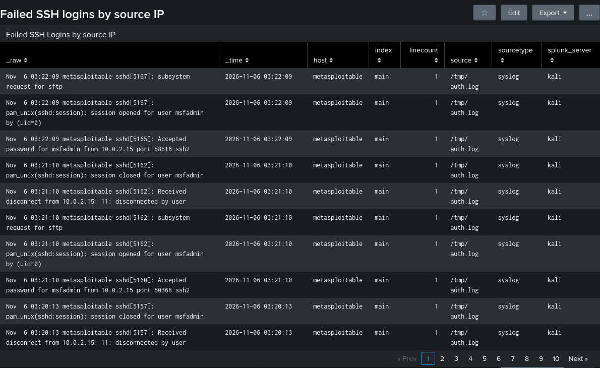

# SSH Brute Force Detection with Splunk

A hands-on home lab project simulating SSH brute force attacks and building
threshold-based detection in Splunk to identify credential abuse patterns.

## Objective

Simulate real-world SSH brute force attacks against a vulnerable target,
then build a Splunk detection pipeline capable of identifying the attack
pattern in near real-time — including a dashboard for visibility and an
automated alert for detection.

## Lab Architecture

| Component | Role | IP |
|---|---|---|
| Kali Linux | Attacker + SIEM (Splunk) | 10.0.2.15 |
| Metasploitable2 | Victim (SSH target) | 10.0.2.7 |

Both VMs run in VirtualBox on a NAT Network, isolated from the host's
production network.

**Data flow:**
```
Hydra (attack) → Metasploitable2 auth.log → scp pull (cron, every 1 min)
→ Kali local file → Splunk file monitor input → SPL detection query
→ Dashboard + Scheduled Alert
```

## Attack Simulation

Used THC-Hydra to brute force SSH login against the `msfadmin` account:

```bash
hydra -l msfadmin -P /usr/share/wordlists/rockyou.txt -t 4 ssh://10.0.2.7
```

- `-l msfadmin` — target username
- `-P rockyou.txt` — password wordlist
- `-t 4` — 4 parallel threads (reduced from default 16 to avoid
  overwhelming the legacy SSH daemon)

**Note:** Metasploitable2 ships with a 2010-era OpenSSH server that only
supports legacy key exchange and MAC algorithms. Modern SSH clients
disable these by default, so `/etc/ssh/ssh_config` on Kali required:

```
Host *
    KexAlgorithms +diffie-hellman-group1-sha1
    HostkeyAlgorithms +ssh-rsa
    PubkeyAcceptedAlgorithms +ssh-rsa
    MACs +hmac-md5,hmac-sha1
    Ciphers +aes128-cbc,3des-cbc
```

## Log Collection

**Initial approach:** Configure Metasploitable2's `sysklogd` to forward
`auth.log` events to Splunk via UDP (`/etc/syslog.conf`: `*.* @<kali-ip>:1514`).

This config was correct and UDP connectivity was verified working
(confirmed via `tcpdump` and `netcat` tests), but `sysklogd`'s internal
forwarding-suspension mechanism repeatedly blocked delivery after any
failed attempt, even after restarts — a known limitation on this legacy
syslog daemon.

**Workaround:** Pull `/var/log/auth.log` directly via `scp`, scheduled
with cron every minute:

```bash
#!/bin/bash
sshpass -p 'msfadmin' scp -o StrictHostKeyChecking=no \
  msfadmin@10.0.2.7:/var/log/auth.log /tmp/auth.log
```

```
# crontab -e
* * * * * /home/kali/pull_auth_log.sh
```

Splunk then monitors `/tmp/auth.log` via a **Files & Directories** input
(sourcetype: `syslog`).

## Detection Logic (SPL)

```spl
sourcetype=syslog "Failed password"
| rex field=_raw "Failed password for (invalid user )?(?<user>\S+) from (?<src_ip>\S+) port (?<src_port>\d+)"
| bin _time span=1m
| stats count by _time, src_ip
| where count > 5
```

**Logic:**
1. Filter to failed SSH login events
2. Extract username, source IP, and port via regex
3. Bucket events into 1-minute time windows
4. Count failed attempts per source IP per window
5. Flag any IP exceeding 5 failed attempts/minute as a brute-force pattern

This threshold is adjustable depending on the environment's normal baseline.

## Dashboard

Panel: **Failed SSH Logins by Source IP (>5/min)**


## Alert

- **Type:** Scheduled, cron `*/5 * * * *` (every 5 minutes)
- **Trigger condition:** Number of results > 0
- **Action:** Add to Triggered Alerts, Severity: High


Confirmed firing against live Hydra traffic, detecting up to 129 failed
login attempts per minute from a single source IP.

## Key Takeaways

- Built a full detection pipeline from raw attack simulation to automated
  alerting
- Diagnosed and worked around a legacy syslog forwarding limitation by
  pivoting to a scp/cron-based log collection method
- Practiced SPL regex extraction, time-bucketed aggregation, and
  threshold-based alerting
- Gained hands-on experience with SSH legacy protocol compatibility issues

## Tools Used

- Kali Linux (attacker + Splunk host)
- Metasploitable2 (victim)
- THC-Hydra
- Splunk Enterprise (trial)
- VirtualBox

## Future Improvements

- Add geolocation enrichment for source IPs
- Correlate with successful logins following failed attempts (credential
  stuffing success detection)
- Migrate log forwarding to rsyslog or a Splunk Universal Forwarder for
  a more production-realistic pipeline
